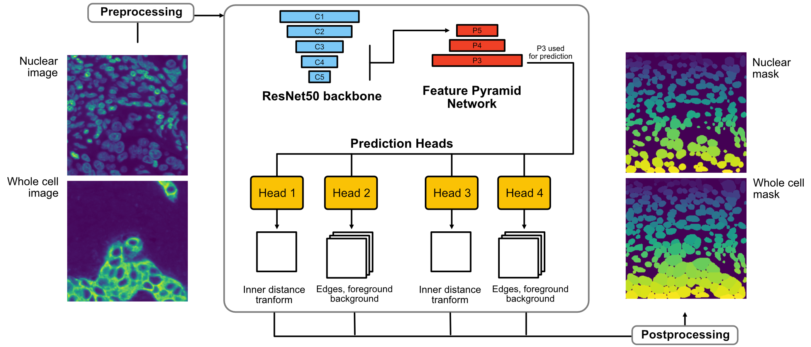
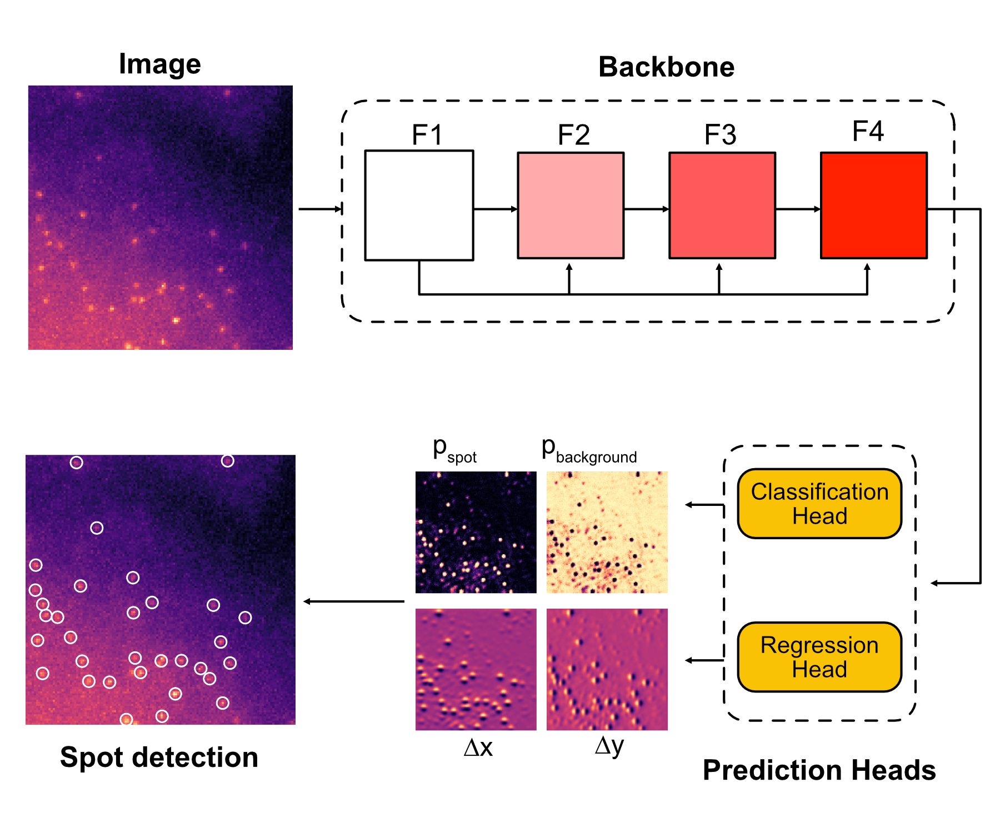
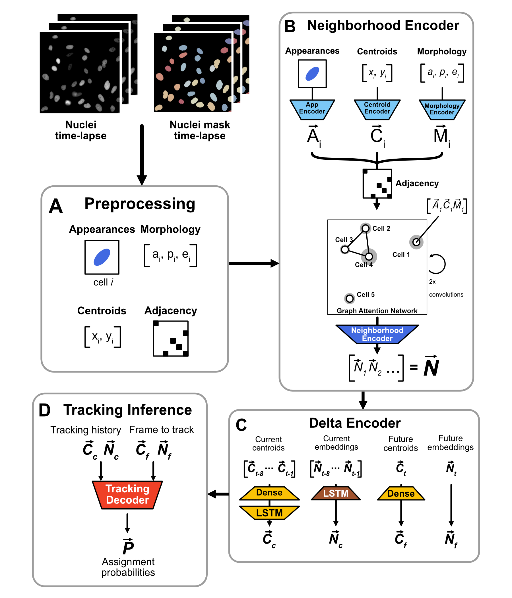
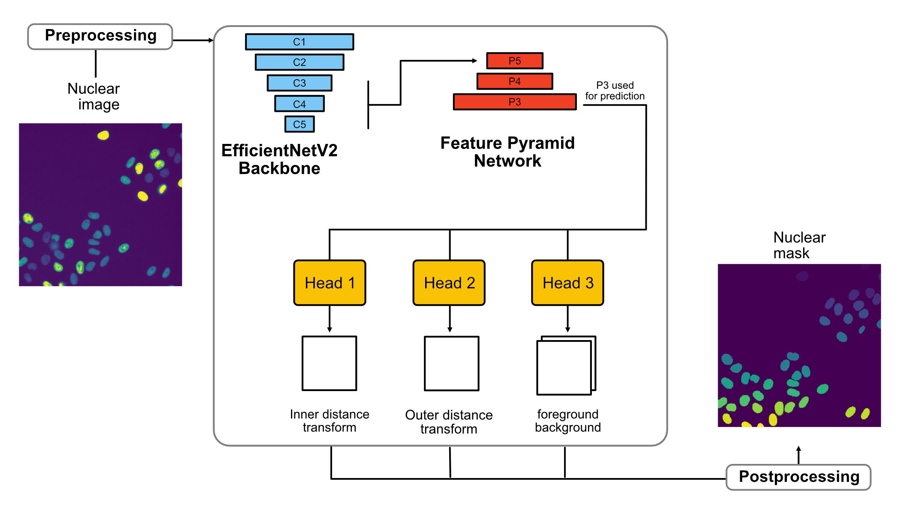

My current work follows a few common threads: optical pooled screening, deep learning tools for microscopy image analysis, and biosensor design and engineering.

## Deep learning tools for microscopy
DeepCell is a suite of deep learning models for analyzing large-scale microscopy images. These models were originally implemented in TensorFlow. In recent years, TensorFlow has been supplanted by PyTorch as the modern framework for implementing deep learning models. I have re-implemented these models in PyTorch and demonstrated that, in addition to equal or better performance, these models can run on platforms that range from data center servers to laptops.

**Check out the models!**

### ☀️ **[torch-mesmer](https://github.com/vanvalenlab/torch-mesmer)**: a PyTorch implementation of Mesmer 
See the original publication: [Whole-cell segmentation of tissue images with human-level performance using large-scale data annotation and deep learning](https://www.nature.com/articles/s41587-021-01094-0)

### ⭐️ **[torch-spots](https://github.com/vanvalenlab/torch-spots)**: a PyTorch implementation spot detection and decoding 
See the original publication: [Accurate single-molecule spot detection for image-based spatial transcriptomics with weakly supervised deep learning](https://www.cell.com/cell-systems/fulltext/S2405-4712(24)00121-2)

### 🌝 **[torch-tracking](https://github.com/vanvalenlab/torch-tracking)**: a PyTorch implementation of Caliban's cell tracking model 
See the original publication: [Caliban: Accurate cell tracking and lineage construction in live-cell imaging experiments with deep learning](https://www.biorxiv.org/content/10.1101/803205v4.full)

### 🌚 **[torch-dynamicnuclearnet](https://github.com/vanvalenlab/torch-dynamicnuclearnet)**: a PyTorch implementation of Caliban's nuclear segmentation model 
See the original publication: [Caliban: Accurate cell tracking and lineage construction in live-cell imaging experiments with deep learning](https://www.biorxiv.org/content/10.1101/803205v4.full)

## Optical pooled screening
Multi-well plates are a mainstay of image-based high-throughput screens, since one well equals one condition. While this allows for many compounds or perturbations to be screened in parallel, we are inherently limited to the number of wells per plate. What if we could pool conditions together and screen several hundred cells expressing different genetic perturbations in the same field of view? I am developing a method that uses repetitive elements in the genome as cellular QR codes. By pooling together cells expressing these so-called "spatial barcodes" and perturbing a mixed population in one field of view, we can read out the barcodes at the end of the experiment and link each cell's response to its genetic perturbation.

## Biosensor design and engineering
Biosensors are indispensable tools in the field of cell biology, but engineering these biosensors is difficult and time consuming. This is primarily due to the enormous search space within proteins: a 100 amino acid protein has a mind-boggling $20^{100}$ variants. With the advent of protein folding and design tools such as AlphaFold3 and RFDiffusion3, we now have access to deep learning models that constrain this search space. This allows us to screen designs *in silico* for poor folders before even touching a pipette. I am currently working on a suite of *de novo* binders for understudied metabolites designed completely with these deep learning tools for use in sensing domains of FRET-based biosensors.